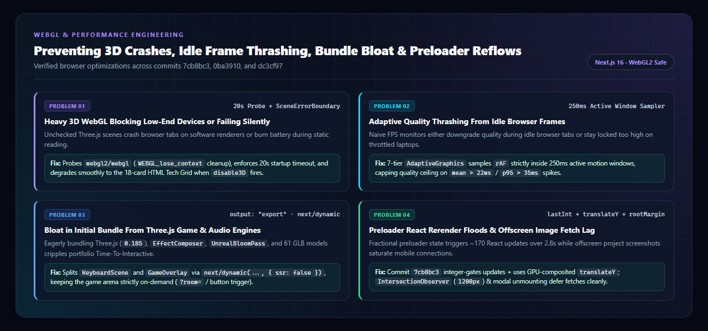
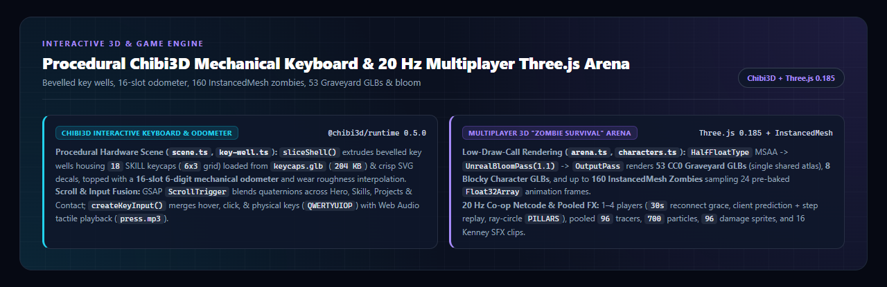
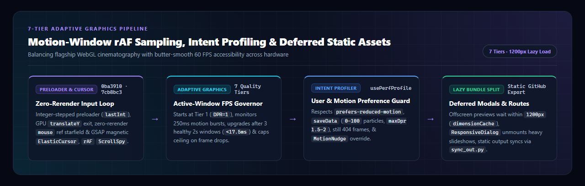
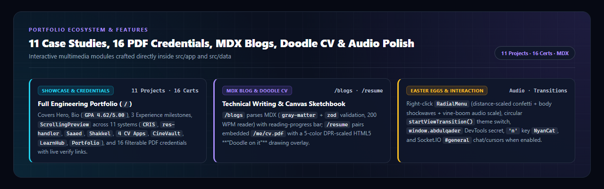
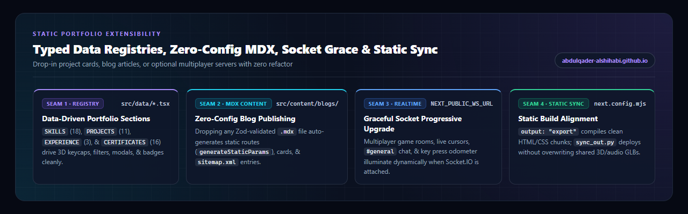

# Abdulqader Alshihabi — 3D Interactive Software & AI Engineer Portfolio

**Next.js `16.2.2` (`React 19.2.4`) Interactive Portfolio Featuring a Procedural `Chibi3D` Mechanical Keyboard (`18` Skill Keycaps + `16`-Slot Odometer), a Code-Split 20 Hz Multiplayer 3D WebGL Game (`Three.js 0.185`), 7-Tier Adaptive Graphics, MDX Blog & HTML5 Doodle Résumé**

[Explore Live Portfolio](https://abdulqader-alshihabi.github.io/) &nbsp;|&nbsp; [Engineering Problems Solved](#four-webgl--performance-problems-solved) &nbsp;|&nbsp; [3D Keyboard & Game Engine](#procedural-chibi3d-keyboard--3d-multiplayer-game) &nbsp;|&nbsp; [7-Tier Adaptive Graphics](#7-tier-adaptive-graphics--performance-engineering) &nbsp;|&nbsp; [Portfolio Map](#complete-portfolio-ecosystem)

---

| Engineering Layer | Verified Stack & Modules | Measurable Guarantee |
| :--- | :--- | :--- |
| **Core Framework** | `Next.js 16.2.2` (`output: "export"`), `React 19.2.4`, `TS 5`, `Tailwind 3.4.1` | Static export served at root (`abdulqader-alshihabi.github.io`) + `robots.txt` / `sitemap.xml` |
| **Interactive 3D Keyboard** | **`@chibi3d/runtime 0.5.0`**, `scene.ts`, `key-well.ts`, `counter-model.ts` | Procedural `sliceShell()` well + `18` `keycaps.glb` keys + **`16`-slot** 6-digit odometer |
| **Multiplayer 3D Game** | **`Three.js 0.185.1`**, `@react-three/fiber 9.8.1`, `EffectComposer`, `UnrealBloomPass` | Lazy `next/dynamic`, 1–4 players (`20 Hz` prediction), `53` Graveyard GLBs + **`160`** horde |
| **Performance Governor** | `adaptive-graphics.ts`, `use-perf-profile.tsx`, `scrolling-preview.tsx` | 7-tier FPS governor (`mean > 22ms` cap), `1200px` `IntersectionObserver`, `lastInt` preloader |
| **Interactive Features** | `GSAP 3.12.5`, `Lenis 1.1.6`, `Motion 12.23.24`, Web Audio API, `canvas-confetti` | Right-click `RadialMenu` shockwaves, `ElasticCursor`, `startViewTransition` theme, Doodle CV |
| **Content & Credentials** | `gray-matter`, `next-mdx-remote`, `zod` | **11 flagship projects**, **16 verified PDF certs**, `/blogs` (`200 wpm`), `/resume` |

---

## Four WebGL & Performance Problems Solved

Rich 3D developer portfolios routinely suffer from four fatal production bugs: broken WebGL contexts lock visitors behind infinite loaders, naive frame monitors thrash quality while scrolling is idle, eager `three.js` game bundles bloat first paint, and fractional React preloader counters trigger hundreds of redundant DOM repaints before page entry.

  

1. **Zero-Crash WebGL Guard & Accessible Fallback (`SceneSession`):** Offscreen `webgl2/webgl` capability probing immediately frees test contexts (`WEBGL_lose_context`) inside a `SceneErrorBoundary` with a hard `20s` boot ceiling—falling back gracefully to the 18-card semantic HTML skill grid when 3D is disabled or unsupported.
2. **Motion-Window Adaptive Frame Monitoring (`adaptive-graphics.ts`):** Starts conservatively at Tier `1` (`DPR = 1`, shadows/bloom off) and samples `rAF` frames *strictly* within `250ms` active interaction windows (`markActive()`), capping max tier permanently on frame spikes (`mean > 22ms` or `p95 > 35ms`).
3. **Strict On-Demand Game Code-Splitting (`next/dynamic({ ssr: false })`):** Keeps `Three.js 0.185`, `EffectComposer`, and `61` `.glb` assets completely out of the initial `/` landing bundle until explicitly triggered (Play button or `?room=` invite link).
4. **GPU-Composited Integer Preloader & Zero-Rerender Loops (`7cb8bc3`, `0ba3910`, `dc3cf97`):** Integer-gated progress (`lastInt`) eliminates ~170 wasted fractional renders over 2.8s while exiting via GPU `translateY`; cursor tracking (`ElasticCursor`), starfield magnetism (`Particles`), and `ScrollSpy` execute purely on `requestAnimationFrame` + passive refs with zero React re-renders.

---

## Procedural Chibi3D Keyboard & 3D Multiplayer Game

  

### Hardware-Inspired 3D Hero Keyboard (`src/components/keyboard/*`)

- **Procedural Key-Well & 18 Interactive Keys:** `sliceShell()` builds rounded bevelled key wells cradling **`keycaps.glb` (`204,284` B)** + **18 white SVG decals (`6x3` grid)** across core stack technologies (`Python`, `Go`, `React`, `PostgreSQL`, `PyTorch`, `OpenCV`, `Django`, `AWS`, `Supabase`, etc.), driving `text3d` labels measured via `heading-metrics.json` and dynamic SVG description cards.
- **16-Slot Roll Odometer & Tactile Wear:** Models a physical `16`-slot mechanical counter (`6` padded drums animated via GSAP) alongside logarithmic roughness polish (`keyWear(count): 0.34 -> 0.12`). Supports fused hover, pointer, and physical keyboard input (`QWERTYUIOP...`) paired with Web Audio keycap acoustics (`/assets/keycap-sounds/{press,release}.mp3`).

### Code-Split Multiplayer "Zombie Survival" Arena (`src/components/game/*`)

- **Instanced Crowd Rendering:** Renders **53 CC0 Kenney Graveyard GLBs** sharing one material atlas alongside **8 Blocky Character GLBs** (`AnimationMixer` `idle/walk/die`) and up to **160 InstancedMesh Zombies** (`Walker`, `Runner`, `Brute`, `Boomer`, `Boss`) sampling **24 pre-baked `Float32Array` animation frames** through an MSAA `HalfFloatType` -> `UnrealBloomPass(1.1)` -> `OutputPass` composer.
- **20 Hz Client-Predicted Co-op & Pooled FX:** Supports 1–4 room players (`RECONNECT_GRACE_MS = 30s`, step replay reconciliation, ray-circle `PILLARS`), pooled `96` bullet tracers, `700` particle buffer points, `8` shockwaves, `96` damage sprites, desktop `WASD` + mobile touch twin-stick, and `16` CC0 Web Audio SFX (`sfx.ts`).

---

## 7-Tier Adaptive Graphics & Performance Engineering

  

- **Deferred Offscreen Previews (`scrolling-preview.tsx`):** `IntersectionObserver` (`rootMargin: "1200px 0px"`) delays loading heavy project preview images while caching intrinsic ratios in `dimensionCache` and unmounting inactive modal carousels (`ResponsiveDialogContent`).

---

## Complete Portfolio Ecosystem

  

- **Curated Engineering Portfolio (`11` Systems + `16` Credentials):** Features projects spanning `IU CRIS` (`https://iu-cris-system.vercel.app/`), `res-handler`, `Saaed ERP`, `Shakkel Learn` & `Store`, `SiteSight`, `Faster R-CNN`, `Bone Fracture Classifier`, `Visual Similarity Search`, `CineVault`, `LearnHub`, and the `Portfolio` itself — plus **16 interactive PDF certificates** (`KAUST Academy`, `DeepLearning.AI`, `IBM`, `University of Michigan`, `Asaqefah & AWS`).
- **Interactive Extras:** `/blogs` static MDX publisher (`gray-matter` + `zod`), `/resume` paired with a 5-color DPR-aware **HTML5 Doodle Canvas** over `/me/cv.pdf`, circular `document.startViewTransition()` theme switch, right-click **`RadialMenu`** (`canvas-confetti` + distance-scaled Web Audio + body shake), DevTools `window.abdulqader` easter egg, `'n'` key `NyanCat`, and reduced-motion-aware `404` memes (`assets/404/*-still.gif`).

---

## Static Portfolio Extensibility

  

> [!NOTE]
> `output: "export"` compiles clean static bundles synchronized directly to the GitHub Pages root via `scratch/sync_out.py` (filtering out unchanged heavy GLB/audio binaries cleanly). Socket.IO features (`#general` chat, remote cursors, game multiplayer rooms, live keystroke counter) activate gracefully whenever `NEXT_PUBLIC_WS_URL` is configured.

[Visit Interactive 3D Portfolio](https://abdulqader-alshihabi.github.io/) &nbsp;|&nbsp; [LinkedIn](https://www.linkedin.com/in/abdulqader-alshihabi-859b19260/) &nbsp;|&nbsp; Built by **Abdulqader Alshihabi**

